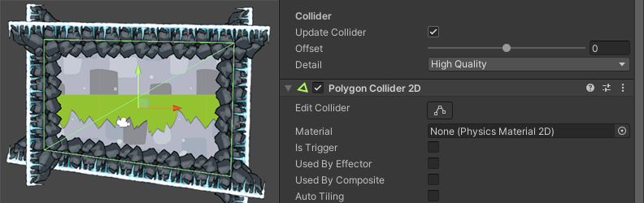

# Add a collider to a sprite shape

Add an Edge Collider 2D or Polygon Collider 2D component to a sprite shape so that other physics objects collide with it. Sprite shapes don't support other collider components.

To use the [2D Physics Core](https://docs.unity3d.com/Packages/com.unity.2d.physics@latest) package instead, add a Physics Area Sprite Shape component. For more information, refer to [Add physics areas to sprite shapes](physics-area-sprite-shape-landing.md).

## Add a collider

To add a collider to a sprite shape, follow these steps:

1. Select a GameObject with a Sprite Shape Controller component in the **Hierarchy** window.
2. In the **Inspector** window, select **Add Component** > **Physics 2D**, then select **Edge Collider 2D** or **Polygon Collider 2D**.

When the sprite shape has one of these components, the **Collision** section appears in the **Sprite Shape Controller** component. When you edit the sprite shape, Unity updates the collider to match its shape. For more information about the **Collision** settings, refer to [Sprite Shape Controller](SSController.md).

## Edit the collider shape manually

By default, Unity reshapes the collider to match the sprite shape every time you edit the sprite shape. To edit the collider shape yourself, disable **Update Collision** in the **Collision** section of the **Sprite Shape Controller** component. Unity then stops updating the collider, so it doesn't overwrite your edits. While **Update Collision** is disabled, the **Offset** and **Detail** settings are hidden.

## Additional resources

- [Edge Collider 2D component reference](https://docs.unity3d.com/Manual/class-EdgeCollider2D.html)
- [Polygon Collider 2D component reference](https://docs.unity3d.com/Manual/class-PolygonCollider2D.html)
