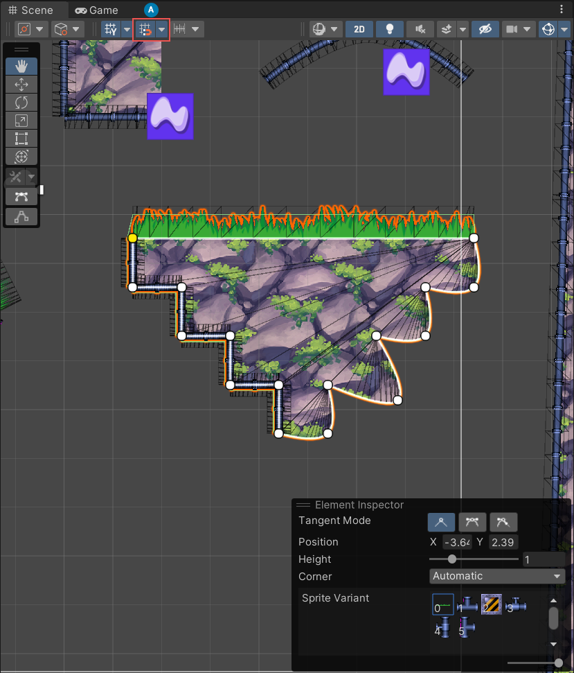

# Sprite Shape Controller component reference

Explore the properties to edit the outline, fill, and collision settings of a sprite shape.

Unity adds the Sprite Shape Controller component to the GameObject it creates when you drag a [Sprite Shape Profile](SSProfile.md) into a scene. The **Inspector** window shows different settings depending on which components the GameObject has. To move, add, and remove the control points of the spline, refer to [Edit the spline of a sprite shape](sprite-shape-edit-spline.md).

## Sprite Shape Controller component properties

The Sprite Shape Controller component contains the following properties.

| **Property** | **Description** |
| :--- | :--- |
| **Profile** | Sets the Sprite Shape Profile that this sprite shape uses. |
| **Edit Spline** |  Makes the control points of the sprite shape visible and editable in the **Scene** view. For more information, refer to [Edit the spline of a sprite shape](sprite-shape-edit-spline.md). |

### Spline

The **Spline** section contains the following properties.

| **Property** | **Description** |
| :--- | :--- |
| **Detail** | Sets the tessellation quality of the rendered sprite shape mesh. The options are **High Quality**, **Medium Quality**, and **Low Quality**. |
| **Bounds Scale** | Scales the bounding box of the sprite shape geometry, so that Unity doesn't cull the sprite shape when a script changes the spline at runtime. |
| **Open Ended** | Leaves both ends of the sprite shape unconnected. Disable it to connect both ends and form a closed shape. |
| **Adaptive UV** | Tiles the sprites seamlessly along the spline by deforming them to fit between control points. Enabled by default. Disable it to tile the sprites at their exact width, with no deformation. When disabled, a sprite might appear cut off if the space between two control points is shorter than the width of the sprite. |
| **Enable Tangents** | Generates tangents for the sprite shape geometry. Enable it for features that need tangent data, such as [2D lights in URP](https://docs.unity3d.com/Manual/urp/2d-index.html). |
| **Update Geometry** | Updates the sprite shape geometry while you edit the sprite shape. Disable it when the sprite shape is static, so that Unity doesn't check for geometry changes each frame. This reduces runtime overhead. |
| **Cache Geometry** | Generates and saves the geometry of the sprite shape while you edit the spline, and uses the saved geometry at runtime instead of generating it again. This property is available only when you select a single GameObject in the scene and **Edit Spline** is active. |
| **Corner Threshold** | Sets how far, in degrees, the angle at a control point can differ from 90 degrees for Unity to treat the control point as a corner. For example, with the default of 30 degrees, a control point is a corner when the angle between its two edges is from 60 to 120 degrees. The range is 0 to 90 degrees. |

### Fill

The **Fill** section contains the following properties.

| **Property** | **Description** |
| :--- | :--- |
| **Fill Tessellation (C# Job)** | Generates the fill geometry with the [job system](xref:um-job-system). Edge geometry always uses the job system. For more information, refer to [Fill Tessellation in a C# Job](FillTessellation.md). |
| **Stretch UV** | Stretches the UV coordinates of the Fill Sprite across the full rectangle of the sprite shape. |
| **Stretch Tiling** | Sets the tiling count of the Fill Sprite when Unity stretches it across the sprite shape. This property is available only when **Stretch UV** is enabled. |
| **Pixels Per Unit** | Sets the scale of the Fill Sprite. Higher values make the sprite smaller. The default is 100. This property is available only when **Stretch UV** is disabled. |
| **Worldspace UV** | Applies the Fill Sprite with world space UV coordinates, instead of UV coordinates for each GameObject. This property is available only when **Stretch UV** is disabled. |

### Custom Geometry

The **Custom Geometry** section contains the following properties. For more information, refer to [Generating Custom Geometry](CustomGeometry.md).

| **Property** | **Description** |
| :--- | :--- |
| **Creator** | Sets the ScriptableObject that generates custom geometry. By default, Unity sets a built-in generator. |
| **Modifier** | Sets a list of ScriptableObjects that modify the generated geometry. |

### Collision

The **Collision** section appears when the GameObject has a Polygon Collider 2D, Edge Collider 2D, or Physics Area Sprite Shape component. For more information, refer to [Add a collider to a sprite shape](SSCollision.md) and [Add physics areas to sprite shapes](physics-area-sprite-shape-landing.md). Unity always optimizes colliders by removing extra control points that are collinear.

The **Collision** section contains the following properties.

| **Property** | **Description** |
| :--- | :--- |
| **Update Collision** | Updates the collider, or the shapes of the Physics Area Sprite Shape component, to match the sprite shape as you edit it. Enabled by default. Disable it to edit the collider shape separately from the sprite shape. When disabled, **Offset** and **Detail** are hidden. |
| **Offset** | Sets how far to extrude the collider mesh toward the edge of the sprite shape. The range is from -0.5 to 0.5. The default is 0. |
| **Detail** | Sets the tessellation quality of the collider. The options are **High Quality**, **Medium Quality**, and **Low Quality**. |

### Shadow

The **Shadow** section appears when Unity generates a shadow shape from the sprite shape, and contains the following properties.

| **Property** | **Description** |
| :--- | :--- |
| **Detail** | Sets the tessellation quality of the shadow shape. The options are **High Quality**, **Medium Quality**, and **Low Quality**. |

## Element Inspector overlay properties

When **Edit Spline** is enabled and you select one or more control points, the **Element Inspector** overlay appears in the **Scene** view.

The **Element Inspector** overlay contains the following properties.

| **Property** | **Description** |
| :--- | :--- |
| **Tangent Mode** | Sets how the tangents of the selected control point shape the spline. For more information, refer to [Set the tangent mode of a control point](sprite-shape-edit-spline.md#set-the-tangent-mode-of-a-control-point). The following options are available:<ul><li> **Linear**: The control point has no tangents, so the spline between it and its neighboring control points is straight.</li><li> **Continuous Mirrored**: The control point has two tangents on opposite sides that curve the spline. The angle between the two tangents is always 180 degrees.</li><li> **Broken Mirrored**: The control point has two tangents on opposite sides that curve the spline. You can change the length and angle of each tangent separately.</li></ul> |
| **Position** | Sets the local x and y coordinates of the selected control point. |
| **Height** | Sets the height of the sprites at the control point, as a factor from 0.1 to 4. |
| **Corner** | Sets whether Unity renders a corner sprite at the control point. The default is **Automatic**. The following options are available:<ul><li>**Disabled**: Doesn't render a corner sprite at the control point.</li><li>**Automatic**: Renders the assigned corner sprite if the control point and its neighbors all use **Linear** mode.</li><li>**Stretched**: Stretches the corner sprite between the adjacent edges. For the requirements, refer to [Stretched corners](#stretched-corners).</li></ul> |
| **Sprite Variant** | Sets the sprite variant that the control point displays. Press **N** to cycle through the available variants. |

### Stretched corners

To stretch the corner sprite between the adjacent edges at a control point, set **Corner** to **Stretched**. The control point and its neighbors must meet the following requirements:

- The selected and adjacent control points have the same **Height**.
- The sprites at the corner control point and its neighbors have the same pivot position.

## Additional resources

- [Add a collider to a sprite shape](SSCollision.md)
- [Add physics areas to sprite shapes](physics-area-sprite-shape-landing.md)
- [Edit the spline of a sprite shape](sprite-shape-edit-spline.md)
- [Sprite Shape Profile](SSProfile.md)
