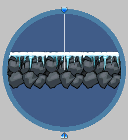
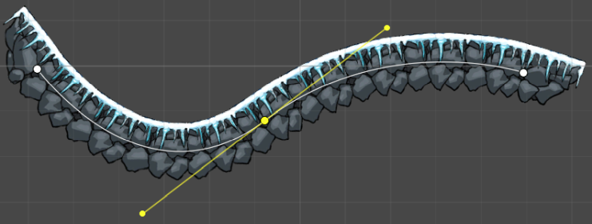

# Sprite Shape Profile

The __Sprite Shape Profile__ contains the settings that determine which sprites appear on a Sprite Shape at specific Angle Ranges, as well as other display settings. You can use the same Profile for multiple __Sprite Shapes__ in a Scene.

Create a Sprite Shape Profile from the Editor main menu (menu: __Assets > Create > Sprite Shape Profile__), and select from the two available options: [Open Shape](#open-shape) and [Closed Shape](#closed-shape).

| **Property**                                                 | **Function**                                                 |
| ------------------------------------------------------------ | ------------------------------------------------------------ |
| **Control Points**                                           | -                                                            |
| **Use Sprite Borders**                                       | Enable to draw the **Sprite Borders** of a Sprite at the Control Point. Define the **Sprite Borders** in the **Sprite Editor**. |
| **Fill**                                                     | -                                                            |
| **Sprite**                                                   | Assign the sprite that fills the enclosed area of the Sprite Shape. The sprite must cover its entire texture and must not be packed into a Sprite Atlas. Set the **Wrap Mode** of its texture to **Repeat** so that Unity can tile the sprite across the Fill area. Unity also applies any [secondary textures](https://docs.unity3d.com/Manual/SpriteEditor-SecondaryTextures.html) on the sprite to the Fill area. This property has no effect if you enable **Open Ended** in the **Sprite Shape Controller**. |
| **Texture (Deprecated)**                                     | Displays the Fill Texture that this Profile renders from, as read only. Assign a Fill Sprite to replace it. This property is visible only if Unity can't automatically upgrade the Fill Texture of the Profile to a Fill Sprite. Refer to [Upgrade a Fill Texture](#upgrade-a-fill-texture). |
| **Offset**                                                   | Determines the border offset at the edges of the Fill Sprite. |
| **Angle Ranges (tool)** | Use this tool to create Angle Ranges and assign Sprites to those ranges. |
| **Start (degrees)**                                          | Enter the starting angle for the selected Angle Range in degrees. |
| **End (degrees)**                                            | Enter the ending angle for the selected Angle Range in degrees. |
| **Order**                                                    | Determines the display priority when Sprites intersect. Sprites with higher values are rendered above lower ones. |
| **Sprites**                                                  | List of Sprites assigned to the selected Angle Range. Displays a list of all Sprites assigned to the selected Angle Range. The order of Sprites in the list determines their **Sprite Variant** number, starting from zero at the top of the list. The first Sprite at the top of the list is the Sprite displayed by default at a Control Point. |
| **Corners**                                                  | -                                                            |
| **(All Corner options)**                                     | Assign specific Sprites to be displayed on the Sprite Shape at the respective corners. |

## Upgrade a Fill Texture

A Fill Sprite defines the Fill area. Profiles from earlier versions of the package use a Fill Texture instead. When Unity imports one of these Profiles, or you open it in the **Inspector** window, Unity automatically upgrades it and replaces the Fill Texture with the sprite of that texture.

Unity upgrades a Profile only if its Fill Texture is imported as a single sprite that covers the whole texture. In any other case, Unity can't determine which sprite to use. If the texture has **Texture Type** set to **Default**, or **Sprite Mode** set to **Multiple**, the Profile keeps rendering from its Fill Texture, and the **Inspector** window shows the texture as read only with a warning. To complete the upgrade, re-import the texture as a single sprite that covers the whole texture, set its **Wrap Mode** to **Repeat**, and assign the sprite to the **Sprite** field.

A Profile that still uses a Fill Texture renders the same way as in earlier versions of the package, but Unity doesn't apply secondary textures to its Fill area.

In scripts, use `SpriteShape.fillSprite`. `SpriteShape.fillTexture` is deprecated. Reading it returns the texture of the Fill Sprite if one is set, and assigning it sets a Fill Texture and clears the Fill Sprite.

## Open Shape
Use the __Open Shape__ preset Profile to create Shapes made from a single edge outline with tiled Sprites along its edge. This preset is ideal for creating level elements such as platforms.

Drag the Open Shape Profile into the Scene view to automatically generate a Sprite Shape with __Open Ended__ enabled in its __Sprite Shape Controller__ settings.

## Closed Shape
Use the __Closed Shape__ preset Profile to create Shapes that encompass an enclosed area. A Closed Shape displays and tiles a Fill Sprite in the enclosed area if you assign a Fill Sprite in its Profile. Use this preset to create large solid filled Shapes that are ideal for backgrounds or large platforms.

Drag the Closed Shape Profile into the Scene view to automatically generate a Sprite Shape with __Open Ended__ disabled in its __Sprite Shape Controller__ settings. The Closed Shape Profile's preset Angle Ranges create a square Sprite Shape by default.

A key feature of the __Sprite Shape Profile__ is the Angle Ranges tool. Assigning an Angle Range determines what Sprite is displayed at specific angles, as the Sprite Shape is deformed in the Scene.

## Creating Angle Ranges

### Method 1:
To create an Angle Range, click the __Create Range__ button at the bottom of the Angle Ranges tool.

The __Create Range__ button is only visible if the __Preview Handle__ is over an area without an Angle Range.

### Method 2:
Another way is to hover your cursor over an empty area of the Angle Range circle. An outline appears to show the possible default angle range. Click to create this Angle Range.

### Editing the Angle Range degrees
The range covered by the currently selected Angle Range is displayed at the bottom of the tool.

You can edit a range by entering new values into __Start__ and __End__, or drag either endpoint of the tool to the desired angles. A range cannot be extended into an existing neighboring range. To delete an Angle Range, select the range and then press the __Del/Delete__ key.

## Assigning Sprites

After creating the Angle Ranges, the next step is to assign Sprites to those ranges. The __Sprites__ list is found beneath the __Angle Ranges__ tool. It lists all the Sprites assigned to the selected range.

To add Sprites to the list, click the __+__ icon to insert a new row to the list.  Click the circle icon next to the empty row to open the __Object Picker__ window, which displays all available Sprites in the project.

You can also drag a Sprite directly onto a row to add it to the list. The Sprite at the top of the list is the default Sprite displayed on the Sprite Shape.  Refer to the other Sprites in the list by their [Sprite Variant](SSController.md) number. See the [Sprite Shape Controller](SSController.md) page for more details.

Drag the leftmost ends of the rows up or down to reorder the list, which changes the __Sprite Variant__ numbers of the Sprites accordingly.

## Previewing Sprites of multiple Angle Ranges

After assigning Sprites to multiple __Angle Ranges__, rotate the Preview Handle around the Angle Range tool to preview the Sprites assigned those ranges.
