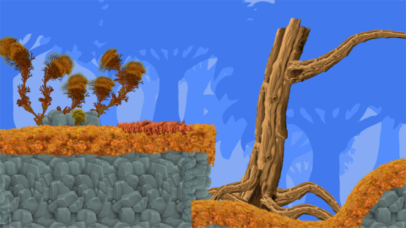

# 2D Sprite Shape

## Overview

A sprite shape is a flexible and powerful world-building asset that features sprite tiling along a shape's outline that automatically deforms and swaps sprites based on the angle of the outline. Additionally, you can assign a Fill Sprite to a Sprite Shape Profile to create filled shapes with tiled sprites as backgrounds or other large level-building props.

The following are examples of sprite shapes used to construct different parts of various levels.

Sprite shapes comprise of two parts - the [Sprite Shape Profile](SSProfile.md) Asset, and the [Sprite Shape Controller](SSController.md) component. The Sprite Shape Profile contains the angle settings and Sprites used by the sprite shape, and you edit the sprite shape's outline with the Sprite Shape Controller component.

## Importing Sprites for sprite shapes

When importing Sprites, use the following [property settings](https://docs.unity3d.com/Manual/TextureTypes.html#Sprite) to ensure that the Sprites are compatible for use with sprite shape:

1. [Texture Type](https://docs.unity3d.com/Manual/TextureTypes.html#Sprite) - Set this to ‘Sprite (2D and UI)’. Other Texture types are not supported for sprite shapes.
2. **Sprite Mode** - Set this to ‘Single’ if the Texture contains only a single Sprite.
3. __Mesh Type__ - This must be set to __Full Rect__ for the Sprite to be used with sprite shape.

In addition, if the Sprites used for the sprite shape are part of a Sprite Atlas, disable both **Allow Rotation** and **Tight Packing** options under the Sprite Atlas’ properties so that the Sprites can be used by the sprite shape.

## Creating a sprite shape general workflow

Create __Sprite Shapes__ with the following steps:

1. Create a **Sprite Shape** GameObject from the main GameObject menu (menu: __GameObject > 2D Object > Sprite Shape__) and select from the two available options:
   - [Open Shape](SSProfile.md#open-shape)
   - [Closed Shape](SSProfile.md#closed-shape)
2. Edit the outline of the sprite shape with the [Sprite Shape Controller](SSController.md) component settings.
3. Enable [Physics 2D](https://docs.unity3d.com/Manual/class-Physics2DManager.html) interactions for your sprite shapes by attaching a collider component. For more information, refer to [Add a collider to a sprite shape](SSCollision.md).

To further customize the shape and outline of a sprite shape:

1. Create a __Sprite Shape Profile__ from the main menu (menu: __Assets > Create > 2D > Sprite Shape Profile__).
2. Create [Angle Ranges](SSProfile.md#creating-angle-ranges) and [assign Sprites](SSProfile.md#assigning-sprites) in the __Sprite Shape Profile__.
3. Assign the __Sprite Shape Profile__ to a __Sprite Shape Controller__'s __Profile__ settings. The same Profile can be used by multiple sprite shapes.

## Placing an Object along the Spline

Place an object along with the spline with the following steps.

1. Select the desired GameObject and add [Sprite Shape Object Placement](SSObjectPlacement.md) component from Add Component in Inspector.
2. Select and assign the source SpriteShapeController in the Inspector.
3. Adjust the ratio, start and end points to position the GameObject along the spline. 
4. Toggle Set Normal to adjust the GameObject to rotate along the direction of the SpriteShapeController.