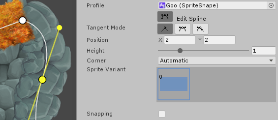
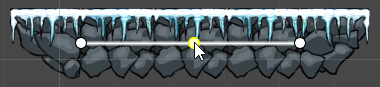
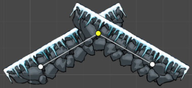
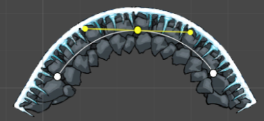
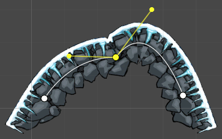

# Edit the spline of a sprite shape

Move, add, and remove the control points of a sprite shape, and set how the spline curves between them.

The spline is the outline of a sprite shape, and Unity tiles the sprites of the Sprite Shape Profile along it. To change the shape and size of a sprite shape, edit the control points of its spline in the **Scene** view.

## Edit the control points

To edit the control points of a sprite shape, follow these steps:

1. Select a GameObject with a Sprite Shape Controller component in the **Hierarchy** window.
2. In the **Sprite Shape Controller** component in the **Inspector** window, select **Edit Spline**. The spline and its control points appear in the **Scene** view.
3. Edit the control points in the **Scene** view:
    - To move a control point, drag it.
    - To add a control point, click the spline between two control points.
    - To remove the selected control point, press **Delete**.

To turn grid snapping on or off while you edit the spline, select the **Global Snap** icon in the **Scene** view toolbar. For more information, refer to [Grid snapping](https://docs.unity.com/en-us/engine/latest/manual/working-with-scenes/scenes-manage-gameobjects/grid-snapping).

## Set the tangent mode of a control point

The tangent mode of a control point sets how the spline curves at that point. Each control point has its own tangent mode. To set it, select the control point, then set **Tangent Mode** in the **Element Inspector** overlay.

To cycle through the tangent modes of a selected control point, press **M**. To change the tangent mode of several control points at once, first set all the selected control points to the same mode, then press **M** or set **Tangent Mode** to another mode.

### Linear mode

In **Linear** mode, a control point has no tangents, so the spline between it and its neighboring control points is a straight line. Where two edges meet at a control point, their sprites might overlap.

To choose which sprite appears on top where they overlap, set their **Order** value in the **Angle Range** settings of the [Sprite Shape Profile](SSProfile.md).

### Continuous Mirrored mode

In **Continuous Mirrored** mode, a selected control point has two tangents on opposite sides, which curve the spline between the control point and its neighbors. Drag the tangents to change the shape of the curve. The angle between the two tangents is always 180 degrees, but their lengths can differ.

Press **B** to mirror the length of the last edited tangent onto the opposite tangent.

### Broken Mirrored mode

In **Broken Mirrored** mode, a selected control point has two tangents on opposite sides, which curve the spline between the control point and its neighbors. Drag each tangent to change its length and angle without changing the other tangent.

Press **B** to mirror the last edited tangent onto the opposite tangent. The opposite tangent takes the same length as the last edited tangent, and points exactly 180 degrees away from it.

## Change the sprite variant at a control point

To change the sprite variant that a selected control point displays, press **N** to cycle through all available variants. You can also select a variant in **Sprite Variant** in the **Element Inspector** overlay.

## Change the keyboard shortcuts

To change the shortcuts for editing the spline, select **Edit** > **Shortcuts**, then select the **Sprite Shape Editing** category.

## Additional resources

- [Add a collider to a sprite shape](SSCollision.md)
- [Sprite Shape Controller component reference](SSController.md)
- [Sprite Shape Profile](SSProfile.md)
